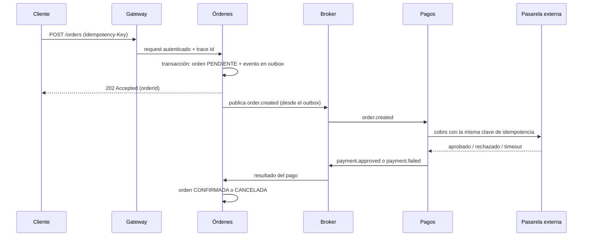

# Guía de cátedra: de TP a producción (parte 2)

**En corto**

- La [parte 1][parte1] recorre qué hace falta para **operar** un producto: operación, seguridad, legal y negocio. Esta parte baja a **cómo se diseña** para producción en un sistema de microservicios como el del TP grupal.
- El hilo es una operación concreta, **una compra**, seguida de punta a punta: contrato, autorización, idempotencia, eventos, reintentos, observabilidad y recuperación.
- Después: [consistencia distribuida](#consistencia-distribuida-el-cobro-doble), [cómo cambiar contratos sin cortar el servicio](#evolucionar-contratos-sin-cortar-el-servicio), [calidad en producción](#calidad-en-producción), [identidad](#identidad-en-producción), [dos casos transversales](#dos-casos-transversales) y un [registro de riesgos](#registro-de-riesgos) para documentar decisiones.
- Los conceptos base (saga, outbox, idempotencia, contract testing) están en las [referencias técnicas][ref-tecnicas]. Acá nos concentramos en qué cambia cuando hay usuarios reales.

---

## Una compra de punta a punta

Tomemos la operación central de un marketplace: un usuario compra un producto. El mismo razonamiento aplica a inscribirse en un curso, reservar un turno o mandar un mensaje con un adjunto.

Cada paso tiene una decisión de producción detrás:

| # | Paso | Decisión de producción | Qué puede salir mal |
| --- | --- | --- | --- |
| 1 | Contrato de API | OpenAPI como fuente de verdad; respuesta `202` con un ID para consultar el estado | El cliente asume que `200` significa "pagado" |
| 2 | Autenticación y autorización | El gateway valida el token; Órdenes valida que el usuario pueda comprar ese producto | Autorización solo en el borde (ver [guía de Auth][guia-auth]) |
| 3 | Idempotencia | El cliente genera una `Idempotency-Key` y la reenvía en cada reintento | Doble clic o reintento de red: dos órdenes, dos cobros |
| 4 | Persistencia | Orden y evento se guardan en la misma transacción (outbox) | Se guarda la orden pero el evento se pierde, o al revés |
| 5 | Publicación de eventos | Un proceso publica desde el outbox y reintenta | El broker está caído: los eventos esperan, no se pierden |
| 6 | Reintentos | Backoff exponencial con *jitter*; diferenciar fallos transitorios de permanentes | Reintentar un rechazo de tarjeta; tormenta de reintentos |
| 7 | Consumidores | Idempotentes y tolerantes a eventos duplicados o fuera de orden | Un `payment.approved` repetido confirma dos veces |
| 8 | Observabilidad | El trace id viaja en headers y en los mensajes del broker | No se puede reconstruir qué pasó con una orden |
| 9 | Alertas | Sobre órdenes que quedan en PENDIENTE más de N minutos | Nadie se entera de pagos colgados |
| 10 | Recuperación | Reconciliación periódica contra la pasarela; cola de mensajes fallidos (DLQ) revisada | Cobros sin orden, órdenes sin cobro |
| 11 | Métrica de negocio | Compras completadas vs. iniciadas, por hora | La API está "verde" pero nadie puede comprar |

Fuentes: [Transactional outbox][outbox], [Saga][saga], [Timeouts, retries and backoff with jitter (AWS)][aws-retries], [Making retries safe with idempotent APIs (AWS)][aws-idempotent].

---

## Consistencia distribuida: el cobro doble

El escenario que más duele en producción, y que no se resuelve con Docker, CI/CD ni monitoreo:

1. Un usuario compra un producto.
2. Pagos cobra en la pasarela.
3. Órdenes falla antes de registrar el resultado.
4. El usuario ve un error y vuelve a intentar.
5. Se produce un segundo cobro.

Lo que lo evita es una combinación de decisiones, no una sola:

- **Idempotencia de punta a punta.** La clave nace en el cliente y llega hasta la pasarela. Stripe cuenta por qué la diseñó así: [Designing robust and predictable APIs with idempotency][stripe-idempotency].
- **Estados explícitos.** Una orden no pasa de "no existe" a "pagada": pasa por PENDIENTE, y el cliente puede consultar el estado en vez de reintentar a ciegas.
- **Outbox y consumidores idempotentes**, para que ningún evento se pierda ni se aplique dos veces.
- **Compensación.** Si el cobro se confirmó pero la orden no puede completarse (sin stock, por ejemplo), la saga dispara un reembolso. Diseñen qué pasa si el reembolso también falla.
- **Reconciliación.** Aun con todo lo anterior, algo se va a escapar. Un proceso periódico que compara los cobros de la pasarela con las órdenes, y alerta sobre las diferencias, es la red de seguridad que usan los sistemas de pagos reales.
- **Mensajes fallidos.** Un mensaje que falla siempre no puede bloquear la cola ni perderse en silencio: va a una DLQ, alguien la mira y existe una forma de reprocesarlo.

---

## Evolucionar contratos sin cortar el servicio

La parte 1 menciona *expand/contract* para la base de datos. En microservicios, el mismo problema aparece entre servicios, porque **no se despliegan todos al mismo tiempo** y en la cola puede haber mensajes viejos esperando.

Ejemplo: el servicio de Catálogo publica `product.updated` con un campo `price` (número) y se decide reemplazarlo por `amount` + `currency`.

1. **Expandir.** Catálogo publica ambos formatos: `price` y también `amount` + `currency`.
2. **Migrar consumidores.** Órdenes y Búsqueda pasan a leer `amount` + `currency`, pero siguen aceptando mensajes que solo traen `price` (ya encolados o de una réplica vieja).
3. **Esperar.** Que no queden consumidores viejos desplegados ni mensajes viejos en las colas.
4. **Contraer.** Catálogo deja de publicar `price`.

Si hay datos históricos que necesitan el formato nuevo, se agrega un *backfill* entre los pasos 2 y 4. La misma lógica aplica a una API REST: agregar es compatible, quitar o cambiar el significado de un campo no lo es. Para detectar roturas antes de desplegar, los **contratos guiados por el consumidor** hacen que el CI del productor falle si rompe lo que un consumidor espera.

Fuentes: [Consumer-Driven Contracts (Martin Fowler)][fowler-cdc], [Schemas, contracts and compatibility (Confluent)][confluent-compat].

---

## Calidad en producción

La pirámide de tests y el test de carga cubren lo que pasa *antes* de desplegar. En producción se suman otras prácticas:

- **Smoke tests después de cada deploy.** Un puñado de requests automáticos sobre el flujo principal. Si fallan, el pipeline vuelve a la versión anterior.
- **Monitoreo sintético.** Un "usuario robot" que cada pocos minutos hace login y una operación clave contra producción, para enterarse antes que los usuarios. ([Synthetic Monitoring (Martin Fowler)][fowler-synthetic])
- **Contract tests en el CI**, como se describió arriba.
- **Probar las migraciones** contra una copia con volumen parecido al real (anonimizada), no solo contra una base vacía.
- **Game days.** Romper algo a propósito en un entorno controlado (tirar una instancia, cortar el broker) y ver si las alertas, los runbooks y la recuperación funcionan. Es la versión chica de la ingeniería del caos. ([Principles of Chaos Engineering][chaos])
- **Medir la entrega.** Las métricas DORA (frecuencia de deploy, tiempo desde el commit hasta producción, tasa de deploys que fallan y tiempo de recuperación) sirven para ver si el proceso mejora. ([DORA][dora])

---

## Identidad en producción

La [guía de Auth][guia-auth] cubre el diseño. En producción, aparecen además:

- **Revocación.** Cuando se suspende o se banea a alguien, sus sesiones, tokens y conexiones abiertas (incluidos los WebSockets) tienen que cortarse en todas las instancias, no cuando venza el token.
- **Cuentas del staff.** MFA obligatorio y permisos por rol en el backoffice, con registro de auditoría.
- **Ciclo de vida de la cuenta.** Qué pasa con una cuenta inactiva, eliminada o recuperada; qué se borra, qué se anonimiza y qué se conserva por obligación legal.
- **Recuperación sin enumeración.** El recupero de contraseña no tiene que revelar si un email está registrado, y tiene que tener límite de intentos.

---

## Dos casos transversales

Un mismo producto genera problemas distintos en cada frente. Estos dos casos muestran cómo se cruzan:

**Caso A: marketplace**

| Frente | Qué aparece |
| --- | --- |
| Operación | Disponibilidad y correctitud del checkout; órdenes colgadas en PENDIENTE |
| Seguridad | Autorización por objeto en órdenes y direcciones; idempotencia de pagos |
| Legal | Datos personales y de envío; derecho de arrepentimiento en compras a distancia |
| Confianza | Fraude, vendedores falsos, reseñas manipuladas, publicaciones prohibidas |
| Negocio | Comisión por transacción; costo de conseguir compradores *y* vendedores; liquidez |

**Caso B: plataforma de mensajería**

| Frente | Qué aparece |
| --- | --- |
| Operación | Latencia de entrega y reconexión sin pérdida de mensajes; múltiples instancias |
| Seguridad | Privacidad de mensajes directos; revocación de sesiones abiertas |
| Legal | Retención y borrado de mensajes; transferencias internacionales del proveedor de voz o video |
| Confianza | Denuncias, bloqueo, spam coordinado, contenido ilegal |
| Negocio | Retención como métrica central; costo por usuario activo dominado por egreso y media |

Hagan el ejercicio con el producto de su cuatrimestre: armen la misma tabla y marquen qué fila los preocupa más.

---

## Registro de riesgos

La checklist de la parte 1 sirve para saber dónde están parados. Para **documentar decisiones**, un registro de riesgos es más útil. Ejemplo:

| Requisito | Riesgo que mitiga | Evidencia | Criticidad | Responsable | Estado |
| --- | --- | --- | --- | --- | --- |
| Restore probado de la base de órdenes | Pérdida de datos irreversible | Acta del restore del 10/11, 14 min | P0 | Ana | Hecho |
| Reconciliación diaria con la pasarela | Cobros sin orden | Job programado + alerta de diferencias | P0 | Tomás | En curso |
| Alta disponibilidad multi-región | Caída de una región del proveedor | — | P2 | — | **Aceptado**: costo desproporcionado para la escala actual |

La última fila es la más importante: un riesgo **aceptado y justificado** es una decisión de ingeniería; un riesgo ignorado es un accidente esperando. Si la decisión es relevante, merece un ADR.

---

## Para seguir leyendo

| Tema | Recurso | Tipo |
| --- | --- | --- |
| Sistemas distribuidos y datos | [Designing Data-Intensive Applications][ddia], Martin Kleppmann | Libro |
| Arquitectura que evoluciona | [Building Evolutionary Architectures][evolutionary], Ford, Parsons, Kua y Sadalage | Libro |
| Rendimiento de la entrega | [Accelerate][accelerate], Forsgren, Humble y Kim | Libro |
| Descubrimiento de producto | [Continuous Discovery Habits][discovery], Teresa Torres | Libro |
| Métricas de producto | [Lean Analytics][lean-analytics], Croll y Yoskovitz | Libro |
| Decisiones de tecnología | [Thoughtworks Technology Radar][radar] | Opinión de la industria |

Y para volver a lo básico: [parte 1 de esta guía][parte1], [referencias técnicas][ref-tecnicas] y la sección [De TP a Producción][material] del material.

[parte1]: https://ingenieria-del-software-2.github.io/blog/2026-11-11-de-tp-a-produccion/
[ref-tecnicas]: https://ingenieria-del-software-2.github.io/tps/referencias-tecnicas/
[guia-auth]: https://ingenieria-del-software-2.github.io/blog/2026-04-03-auth/
[material]: https://ingenieria-del-software-2.github.io/material/#produccion
[outbox]: https://microservices.io/patterns/data/transactional-outbox.html
[saga]: https://microservices.io/patterns/data/saga.html
[aws-retries]: https://aws.amazon.com/builders-library/timeouts-retries-and-backoff-with-jitter/
[aws-idempotent]: https://aws.amazon.com/builders-library/making-retries-safe-with-idempotent-APIs/
[stripe-idempotency]: https://stripe.com/blog/idempotency
[fowler-cdc]: https://martinfowler.com/articles/consumerDrivenContracts.html
[confluent-compat]: https://www.confluent.io/blog/schemas-contracts-compatibility/
[fowler-synthetic]: https://martinfowler.com/bliki/SyntheticMonitoring.html
[chaos]: https://principlesofchaos.org/
[dora]: https://dora.dev/
[ddia]: https://dataintensive.net/
[evolutionary]: https://evolutionaryarchitecture.com/
[accelerate]: https://itrevolution.com/product/accelerate/
[discovery]: https://www.producttalk.org/continuous-discovery-habits/
[lean-analytics]: https://leananalyticsbook.com/
[radar]: https://www.thoughtworks.com/radar

